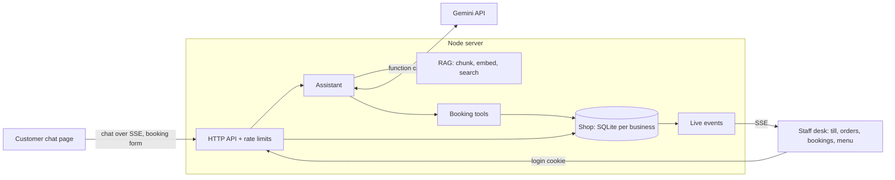

# RAG Support Bot + Shop Desk

[](https://github.com/Kx1742/rag-support-bot/actions/workflows/ci.yml)

A customer-support chatbot for small businesses that **answers questions from the business's own
documents** and **books tables by chatting**, plus a **staff desk** with a till (POS), a kitchen
order queue, a bookings list and menu controls, all updating live.

- **Customers** chat on the website: "Do you have oat milk?", "Table for 4 on Saturday at 10?"
- **The AI** (Google Gemini) answers from the café's documents with citations, and checks availability
  and makes bookings through function calling, using the shop's real booking rules
- **Staff** see new bookings appear instantly on the desk, ring up orders at the till, and move
  orders through New → Preparing → Ready

It's multi-tenant: each business is a folder with its own documents, menu, tables and opening hours.

> The demo business, **Bean & Byte Café**, is fictional. Its documents and menu are made up for this project.

<!-- TODO: add screenshots or a GIF of the chat and the desk here -->

## Features

**Customer chat** (`/`)
- Grounded answers with clickable citations, streamed over Server-Sent Events
- **Books and cancels tables in conversation** (Gemini function calling), always confirming first
- "Book a table" form in the chat, which also works without AI
- Follow-up questions, suggested questions, business branding, dark mode, works on phones

**Staff desk** (`/desk`, password protected)
- **Till / POS**: menu grid by category, ticket with quantities, takeaway or dine-in by table
- **Order queue**: New → Preparing → Ready → Picked up, with today's sales summary
- **Bookings**: day view, seat, finish, no-show and cancel, plus phone and walk-in bookings with table choice
- **Menu**: mark items sold out; the till greys them out immediately
- **Live updates**: new bookings (on any date) and orders appear on every open desk screen instantly
- Payments are deliberately not handled yet (see roadmap)

**Engineering**
- Zero runtime dependencies: Node's built-in `node:http`, `node:sqlite` and `fetch`
- Booking rules enforced server-side: opening hours, slot grid, notice period, table sizes,
  overlap checks, per-phone limits
- Prices always come from the database, never from the browser
- Rate limiting, a daily AI message cap, strict Content-Security-Policy, no `innerHTML`
- 78 tests, all offline: fake AI, in-memory SQLite, real HTTP server on a random port

## How it works



### Answering questions (RAG)
1. Documents are split by Markdown heading into chunks, embedded with `gemini-embedding-001`, and saved.
2. Each question is searched on its own **and** with the previous question (for follow-ups),
   keeping each chunk's best score.
3. Gemini answers using only the numbered sources and cites them. With no relevant sources
   and no tools, the bot gives the contact details instead of guessing.

### Booking by chat (function calling)
1. The system prompt gives Gemini today's date, a 14-day calendar (models are bad at date maths)
   and the booking rules.
2. Gemini calls `check_availability`. Our code runs the real rules and returns free times or the
   closest alternatives.
3. Gemini summarises the details and asks the customer to confirm. Only after a clear "yes" does
   it call `create_booking`.
4. The chat shows a confirmation card with the reference, and the desk announces the new booking live.

Rule violations ("we seat up to 6") are returned to the model as tool results so it can explain
them. Unexpected errors are not.

## Design decisions

| Decision | Why |
|---|---|
| Channel-independent `Assistant` with pluggable tools | Web chat today, WhatsApp next, same brain. |
| `node:sqlite`, one database file per business | Real transactions with zero dependencies, and tenants can't see each other's data. |
| Times stored as shop wall-clock values (`2026-11-14`, minute 600) | Only "now" needs a timezone conversion, which avoids most daylight-saving bugs. |
| Smallest free table that fits | Keeps big tables free for big groups. |
| Customer cancel needs reference **and** phone, same error for both | References can't be guessed or probed. |
| HttpOnly + SameSite=Strict session cookie, JSON-only writes | Blocks cross-site request forgery without CSRF tokens. |
| Constant-time password check, login rate limit | No timing leaks or brute force. |
| Server-Sent Events for the desk | Simple one-way live updates over plain HTTP. |
| Offline mode (keyword search, no AI) | Develop and demo without an API key. |

## Getting started

Requires **Node.js 23.6+**, which runs TypeScript directly with no build step.

```bash
npm install
cp .env.example .env    # set STAFF_PASSWORD (8+ chars); add GEMINI_API_KEY for AI answers
npm start
```

- Customer chat: http://localhost:3000
- Staff desk: http://localhost:3000/desk (business ID `bean-and-byte`, password from `.env`)

Without `GEMINI_API_KEY` the chat runs in **offline mode**: keyword search, no AI-written answers,
and bookings through the form only. Get a free key at https://aistudio.google.com/apikey.

Other commands:

```bash
npm run dev                   # restart on file changes
npm run chat -- bean-and-byte # chat in the terminal
npm test                      # 78 tests
npm run typecheck
```

### Add your own business

```text
tenants/
  my-shop/
    tenant.json   # name, assistant name, tone, contact, brand color, suggested questions
    shop.json     # optional: timezone, opening hours, tables, booking rules, menu with prices
    docs/*.md     # FAQs, policies, menu text for the chatbot
```

Without `shop.json` the business gets the chatbot only. Data is stored in `data/<id>/` (git-ignored).

### API

| Method | Path | Description |
|---|---|---|
| `GET` | `/api/tenants/:id` | Public business info |
| `POST` | `/api/tenants/:id/chat` | Chat. Body `{ message, history }`; responds with an SSE stream (`sources`, `action`, `delta`, `done`) |
| `GET` | `/api/tenants/:id/availability?date=&partySize=` | Free booking times |
| `POST` | `/api/tenants/:id/bookings` | Book a table: `{ date, time, partySize, name, phone, notes? }` |
| `POST` | `/api/desk/login`, `/api/desk/logout` | Staff session (cookie) |
| `GET`, `POST`, `PATCH` | `/api/desk/orders`, `/api/desk/orders/:id` | Till and order queue |
| `GET`, `POST`, `PATCH` | `/api/desk/bookings`, `/api/desk/bookings/:id` | Bookings by day, status changes |
| `GET`, `PATCH` | `/api/desk/menu`, `/api/desk/menu/:id` | Menu and sold-out flags |
| `GET` | `/api/desk/events` | Live change events (SSE) |

## Roadmap

- [x] RAG engine with citations, multi-tenant
- [x] Streaming web chat, rate-limited API, offline mode
- [x] Table bookings: rules engine, chat booking via function calling, booking form
- [x] Staff desk: till, order queue, bookings, menu, live updates
- [ ] Payments at the till (Stripe test mode first)
- [ ] Per-staff accounts and roles instead of one shared password
- [ ] Deploy a live demo
- [ ] Booking confirmations by SMS/email; WhatsApp channel
- [ ] Customers order ahead through the chat

## Privacy note

Bookings store a name and phone number in the business's local database. On Gemini's free tier,
Google may use prompts to improve its products, so don't use real customer data with the demo.
Use the paid tier for real businesses.

## License

MIT
