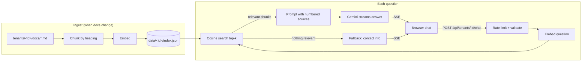

# RAG Support Bot

[](https://github.com/Kx1742/rag-support-bot/actions/workflows/ci.yml)

A customer-support chatbot that answers questions **from a business's own documents**
(menu, hours, policies, FAQs) using Retrieval-Augmented Generation and Google Gemini.
It streams answers into a web chat, cites its sources, and says "I don't know" instead
of inventing answers.

It's built to support many businesses: each one is a **tenant** with its own documents,
branding and settings. Adding a new business means adding a folder, not changing code.

> The demo business, **Bean & Byte Café**, is fictional. Its documents are made up for this project.

<!-- TODO: add a screenshot or GIF of the chat here -->

## Features

- **Grounded answers with citations**: every fact links to the document it came from, and you can click a citation to see the source text
- **Streaming responses** over Server-Sent Events
- **Follow-up questions**: "and on Sunday?" understands the earlier question
- **Multi-tenant**: per-business documents, assistant name, tone, brand color and suggested questions
- **Abuse protection**: per-visitor rate limiting, a daily message cap, input validation and size limits
- **Offline mode**: runs with no API key using local keyword search, for development and demos
- **Secure by default**: API key stays on the server, strict Content-Security-Policy, no `innerHTML`
- Light/dark mode, works on phones, no frontend framework or build step

## How it works



1. **Chunking**: documents are split by Markdown headings so each chunk covers one topic.
   Each chunk keeps its heading path (`Refund Policy > Gift Cards`) for better retrieval.
2. **Embedding and indexing**: chunks are embedded with `gemini-embedding-001` (768 dimensions)
   and saved as JSON. A content hash skips re-embedding when nothing changed.
3. **Retrieval**: the question is searched on its own **and** together with the previous
   question, keeping each chunk's best score. This handles follow-ups without letting an
   unrelated earlier question drown out a new topic.
4. **Grounded answer**: if nothing scores above the threshold, the bot returns the business's
   contact details **without calling the LLM**. This saves quota and prevents made-up answers.
   Otherwise Gemini answers using only the numbered sources and cites them.
5. **Streaming**: the server sends `sources`, then `delta` pieces, then `done` as Server-Sent
   Events. The UI only lists sources the answer actually cites.

## Design decisions

| Decision | Why |
|---|---|
| Channel-independent `Assistant` class | Web chat, WhatsApp, etc. are thin adapters over the same core. |
| `EmbeddingProvider` / `ChatProvider` interfaces | Swap Gemini for another model, run offline, and use fakes in tests. |
| Plain REST + `node:http`, zero runtime dependencies | Small attack surface, nothing to keep patched, and easy to read. |
| Brute-force vector search | Simple and fast for a few thousand chunks per business. pgvector is the upgrade path. |
| Documents marked as data in the prompt | Basic defence against prompt injection hidden in uploaded docs. |
| Token-bucket rate limit + daily cap | A public demo can't burn through the free API quota. |
| Allow-listed static files, validated tenant ids | No path tricks (`../`) can reach other files. |
| Internal errors logged, generic message to the browser | Upstream error details never leak to visitors. |

## Getting started

Requires **Node.js 23.6+**, which runs TypeScript directly with no build step.

```bash
npm install
npm start                     # open http://localhost:3000
```

With no API key this runs in **offline mode** (keyword search, shows the matching text).
For real AI answers, get a free key at https://aistudio.google.com/apikey, then:

```bash
cp .env.example .env          # paste your key into GEMINI_API_KEY
npm start
```

Other commands:

```bash
npm run dev                   # restart the server when files change
npm run chat -- bean-and-byte # chat in the terminal
npm run ingest -- bean-and-byte --force
```

### Add your own business

```text
tenants/
  my-shop/
    tenant.json      # name, assistant name, tone, fallback contact, brand color, suggested questions
    docs/
      faq.md
      prices.md
```

Open `http://localhost:3000/?tenant=my-shop`. The index is built automatically on the first question.

### API

| Method | Path | Description |
|---|---|---|
| `GET` | `/api/tenants/:id` | Public business info (name, brand color, suggested questions) |
| `POST` | `/api/tenants/:id/chat` | Body `{ "message": "...", "history": [{ "role": "user", "text": "..." }] }`. Responds with a Server-Sent Events stream. |
| `GET` | `/api/health` | Health check |

## Tests

```bash
npm test          # 41 tests, run offline: fake embeddings, fake HTTP, real server on a random port
npm run typecheck
```

## Roadmap

- [x] RAG engine: chunking, embeddings, retrieval, grounded answers with citations
- [x] Multi-tenant document folders
- [x] Web chat UI with streaming responses
- [x] HTTP API with rate limiting (keeps the API key on the server)
- [ ] Deploy a live demo
- [ ] Upload your own documents (PDF/TXT)
- [ ] WhatsApp channel via the WhatsApp Business Cloud API
- [ ] Admin dashboard: unanswered questions, so businesses know which docs to add

## Privacy note

On Gemini's free tier, Google may use prompts to improve its products. Don't upload
sensitive or real customer data to the demo. For real businesses, use the paid tier.

## License

MIT
