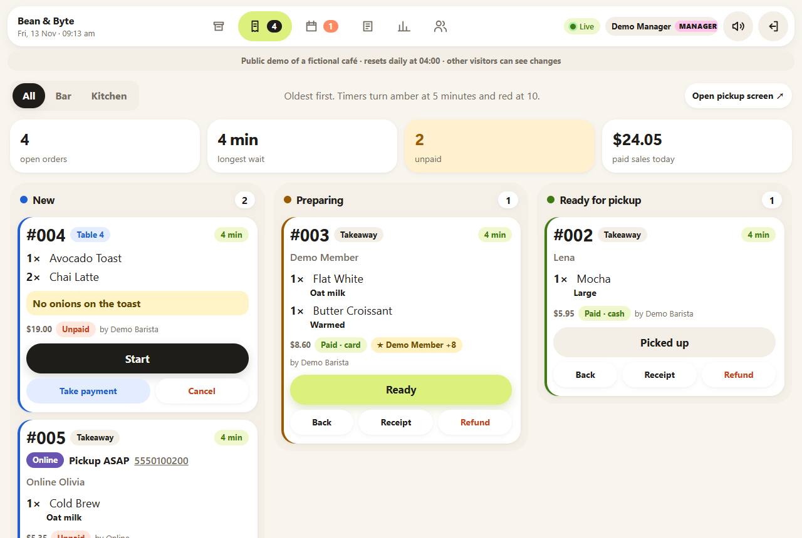
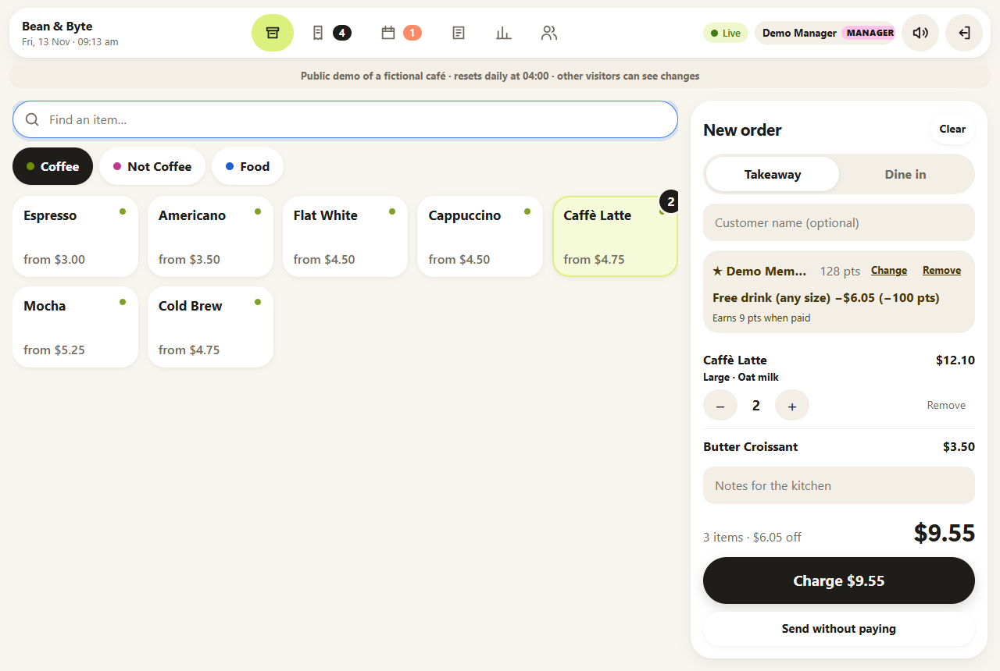
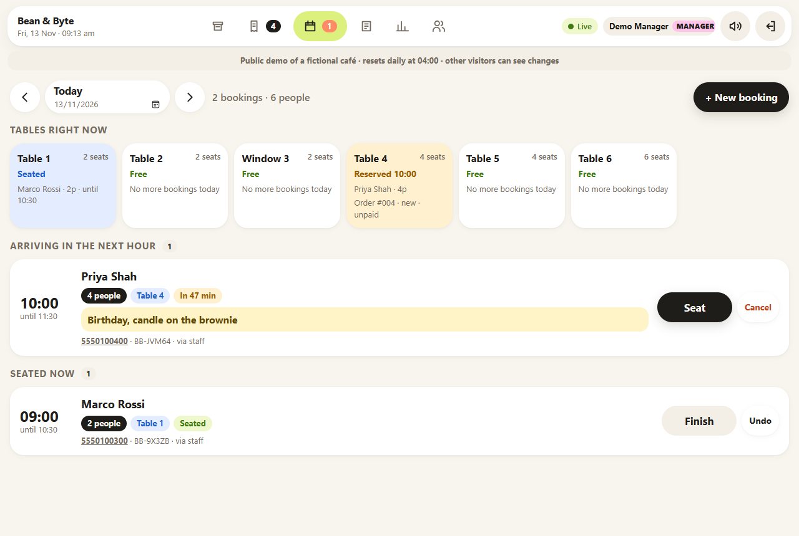
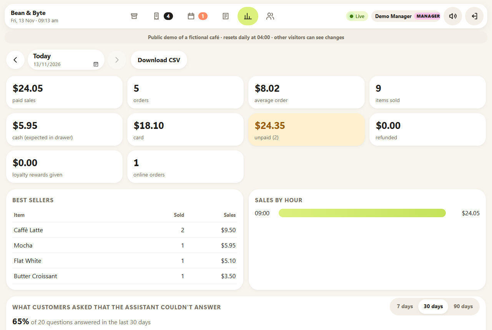
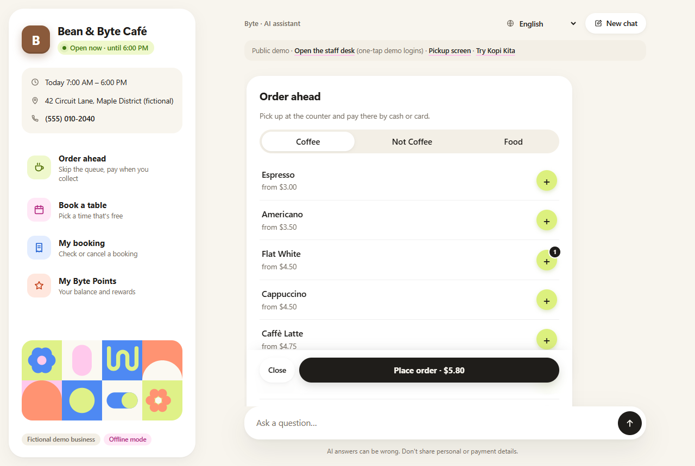
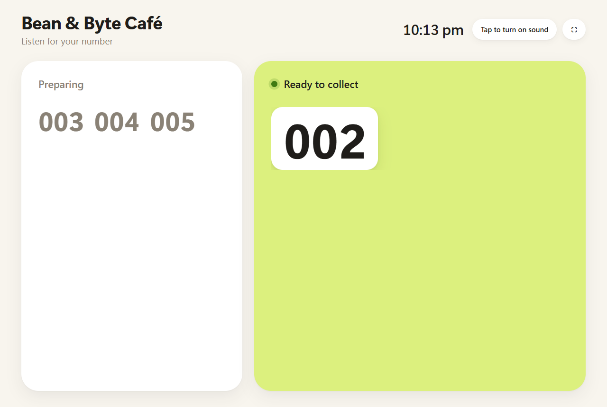
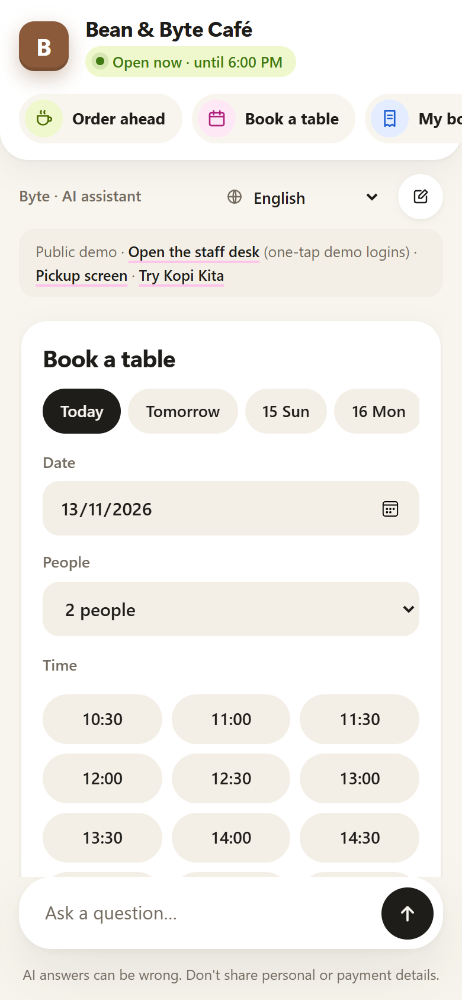
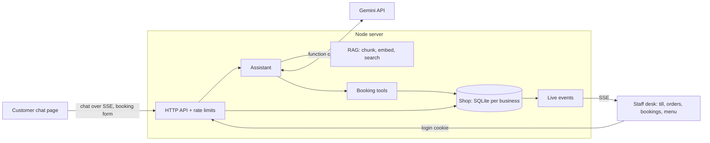

# RAG Support Bot + Shop Desk

[](https://github.com/Kx1742/rag-support-bot/actions/workflows/ci.yml)

A customer-support chatbot for small businesses that **answers questions from the business's own
documents** and **books tables by chatting**, plus a **staff desk** with a till (POS), a kitchen
order queue, a bookings list and menu controls, all updating live.

- **Customers** chat on the website: "Do you have oat milk?", "Table for 4 on Saturday at 10?"
- **The AI** (Google Gemini) answers from the café's documents with citations, and checks availability
  and makes bookings through function calling, using the shop's real booking rules
- **Staff** see new bookings appear instantly on the desk, ring up orders with drink options,
  take cash or card payment, and move orders through New → Preparing → Ready
- **Managers** also refund orders, see the end-of-day sales report, and manage staff accounts

It's multi-tenant: each business is a folder with its own documents, menu, tables, opening hours,
currency, taxes and payment methods. The demo runs two very different cafés from the same code:

| | **Bean & Byte Café** | **Kopi Kita** (`/?tenant=kopi-kita`) |
|---|---|---|
| Style | Specialty coffee, US | Modern kopitiam, Petaling Jaya, Malaysia |
| Money | US dollars | Ringgit (RM), cash rounded to the nearest 5 sen |
| Tax | None | 6% SST on everything, 10% service charge for dine-in only |
| Payments | Cash, card | Cash, card, **DuitNow QR** |
| Documents | English | English, 中文 and Bahasa Melayu |
| Menu | Lattes with size and milk options | Kopi, teh tarik (hot/iced, kurang manis/kosong), nasi lemak with add-ons, kuih |

> Both businesses are fictional. Their documents and menus are made up for this project.

**Live demo:** _coming soon_ <!-- TODO: paste the Render URL here after deploying -->
In the demo, open the staff desk and tap **Try as Barista** or **Try as Manager**. Switch café with the
**Try Kopi Kita** / **Try Bean & Byte Café** link in the chat. The data resets every night.

## Screenshots

| Kitchen display | Till with a loyalty reward |
|---|---|
|  |  |

| Bookings and live table map | End-of-day report (managers) |
|---|---|
|  |  |

| Customer chat: order ahead | Pickup screen | Phone |
|---|---|---|
|  |  |  |

<sub>Captured from the public demo with `npm run screenshots`, which drives a headless Edge/Chrome, so they're easy to refresh after design changes.</sub>

## Features

**Customer chat** (`/`)
- **Calm, friendly design**: cream background, white panels on soft shadows (no hard outlines), pastel
  lime/pink/blue/coral accents and playful geometric tiles; a café panel shows **open now / opens at…**, today's hours, address and
  tap-to-call phone, with the four actions as colour-coded buttons (a compact swipeable row on phones)
- **Easy flows**: order total stays pinned while browsing the menu, + buttons show how many are in the
  order, one-tap "Today / Tomorrow / Sat 15" dates for bookings, cards open at their title, tapping an
  action twice brings back the open form instead of a duplicate, Esc closes a form
- Grounded answers with clickable citations, streamed over Server-Sent Events
- **Books and cancels tables in conversation** (Gemini function calling), always confirming first
- "Book a table" form in the chat, which also works without AI
- **Order ahead**: pick items and drink options, choose a pickup time, pay at the counter; the order
  appears on the kitchen screen and the pickup screen
- **Live order tracking**: the confirmation card follows the order (Received → Being made → Ready to
  collect) and chimes when it's ready; it survives a page reload and uses a private per-order link;
  once collected and paid it offers a **digital receipt**
- **My booking**: look up or cancel your own booking with its reference + phone number
- **My points**: check a loyalty balance and rewards by phone number
- **English, 中文 and Bahasa Melayu**: picked from the customer's browser, switchable in the header and
  remembered; the AI replies in whatever language the customer writes in
- **Knows what's sold out**: with Gemini it reads the live menu (prices, sold out, "only 3 left");
  offline it adds a "Heads up: … is sold out today" notice

**Pickup screen** (`/display`, for a TV at the counter)
- Big "Preparing" and "Ready to collect" order numbers, updated live, newest call first, with a chime
- Shows order numbers only: no names or items
- Language set in its link, e.g. `/display?lang=zh` or `?lang=ms`
- Follow-up questions, suggested questions, business branding, dark mode, works on phones
- **Installable app (PWA)**: add the desk or the chat to a tablet/phone home screen; pages still open on flaky Wi-Fi (live data is never cached)

**Malaysia-ready** (all set per business in `shop.json`)
- **SST and service charge**: any list of percentage charges, in order, each on the amount so far
  (so SST is also charged on the service charge, as Malaysian law requires); charges can be dine-in only
- **Cash rounding** to the nearest 5 sen (Bank Negara Malaysia's rule); card and QR pay the exact amount;
  the receipt shows the rounding and the amount paid
- **DuitNow QR** as a payment method alongside cash and card, in the till, receipts and the report
- **Prices in the café's own currency** everywhere (RM, $...)
- End-of-day report shows **SST and service charge collected** and QR takings, also in the CSV
- Chinese and Malay questions work even in offline mode (Chinese text is searched in two-character pieces)

**Staff desk** (`/desk`, each person logs in with their own username + PIN)
- Same calm design as the customer site: a floating top bar, white cards on soft shadows, pastel status
  colours (blue new, amber preparing, lime ready, coral late), ink main buttons; works in dark mode
- **Till / POS**: menu grid by category, item search, **drink options** (size, milk, extra shot, iced...)
  with per-item notes, takeaway or dine-in by table
- **Payments**: cash with quick amounts and change due, or card confirmed from the card machine;
  pay now or keep a table's order open and pay later
- **Order queue**: New → Preparing → Ready → Picked up, with waiting timers, paid/unpaid labels
  and who rang each order up
- **Bookings**: day view, seat, finish, no-show and cancel, plus phone and walk-in bookings with table choice
- **Menu**: sold-out switch, **stock counts** (the till counts down, sells out at 0, can't oversell, and
  stock comes back on cancel/refund); managers **add items, change prices and options, hide items**.
  Desk edits survive changes to `shop.json`
- **Live updates**: new bookings (on any date) and orders appear on every open desk screen instantly
- **Loyalty ("Byte Points")**: look up or join members by phone at the till, earn 1 point per $1 paid,
  redeem rewards (free pastry 50, free drink 100, breakfast combo 250); the reward makes the most
  expensive matching item free; points come back on cancel/refund and expire after 12 months idle
- **Online orders** show on the kitchen screen with an Online label, pickup time and tap-to-call phone
- **Bar / Kitchen screens**: each kitchen display can show just its station's items (set in `shop.json`),
  so the barista sees drinks and the kitchen sees food; each device remembers its choice
- **Receipts**: printable receipt for any paid order (also offered right after charging); printing
  outputs just the receipt, sized for a 72 mm receipt printer; café address/phone/footer from `shop.json`
- **Refunds** (managers): with a reason; paid orders can't simply be cancelled
- **End-of-day report** (managers): sales, cash vs card, unpaid, refunds, best sellers, sales by hour, CSV export
- **Staff accounts** (managers): add people, change roles, reset PINs, deactivate
- **What customers asked that the assistant couldn't answer** (managers, in the report): the answer rate
  for the last 7/30/90 days and the missing topics ranked by how often they're asked (different wordings
  are grouped), so the owner knows exactly what to add to their documents; "Added" clears a topic.
  Anonymous: phone numbers and emails are masked before saving, and questions are deleted after 90 days

**Engineering**
- Zero runtime dependencies: Node's built-in `node:http`, `node:sqlite` and `fetch`
- Booking rules enforced server-side: opening hours, slot grid, notice period, table sizes,
  overlap checks, per-phone limits
- Prices and option surcharges always come from the server, never from the browser
- Duplicate-order protection: each till order carries an idempotency key, so a network retry can't charge twice
- Rate limiting, a daily AI message cap, strict Content-Security-Policy, no `innerHTML`
- Production basics: health check that tests the database, HSTS on HTTPS, a request id on every
  response (shown to visitors on errors), request logs that never include query strings
- 171 unit and API tests, all offline: fake AI, in-memory SQLite, real HTTP server on a random port
- **Answer-quality tests** (`npm run eval`, also in CI): each café has a set of real questions in
  `tenants/<id>/eval.json` with the document that should answer them, a phrase the answer must contain,
  and questions the assistant must *not* pretend to answer. The script reports the score, how often the
  right document came first and in the top 3, and fails below the café's minimum. It already caught a
  bug: offline search didn't match "dog" to "Dogs" (short plurals weren't stemmed). `--live` runs it
  against the real AI
- 13 end-to-end browser tests (`npm run e2e`): headless Chrome/Edge clicks through real journeys across several tabs (order ahead with live tracking, till payment with change, table booking, pickup screen, role restrictions, a Malaysian dine-in order with SST paid by DuitNow QR, the unanswered-questions report, switching language, phone layout); they run on every push, with failure screenshots saved

## How it works



### Answering questions (RAG)
1. Documents are split by Markdown heading into chunks, embedded with `gemini-embedding-001`, and saved.
2. Each question is searched on its own **and** with the previous question (for follow-ups),
   keeping each chunk's best score.
3. Gemini answers using only the numbered sources and cites them. With no relevant sources
   and no tools, the bot gives the contact details instead of guessing.

### Booking by chat (function calling)
1. The system prompt gives Gemini today's date, a 14-day calendar (models are bad at date maths)
   and the booking rules.
2. Gemini calls `check_availability`. Our code runs the real rules and returns free times or the
   closest alternatives.
3. Gemini summarises the details and asks the customer to confirm. Only after a clear "yes" does
   it call `create_booking`.
4. The chat shows a confirmation card with the reference, and the desk announces the new booking live.

Rule violations ("we seat up to 6") are returned to the model as tool results so it can explain
them. Unexpected errors are not.

## Roles and permissions

| | Customer | Staff | Manager |
|---|:-:|:-:|:-:|
| Chat, book a table, order ahead, look up own booking or points (public site) | ✓ | ✓ | ✓ |
| Ring up orders, take payments, move orders along | – | ✓ | ✓ |
| Create, seat and cancel bookings; mark items sold out; set stock counts | – | ✓ | ✓ |
| Add menu items, change prices and options, hide items | – | – | ✓ |
| Cancel **unpaid** orders; look up / add loyalty members and redeem rewards | – | ✓ | ✓ |
| Refund paid orders | – | – | ✓ |
| See sales totals and the end-of-day report | – | – | ✓ |
| Add staff, change roles, reset PINs | – | – | ✓ |

- Customers never log in. They prove a booking is theirs with its reference **and** phone number.
- Staff and managers log in at `/desk` with their own **username + PIN** (hashed with scrypt).
  After 5 wrong PINs an account locks for 5 minutes.
- The owner logs in with username `owner` and the `STAFF_PASSWORD` from `.env` (always a manager),
  and uses it to create everyone else's accounts.
- Permissions are checked **on the server on every request** (`src/server/permissions.ts`); the desk only
  hides buttons people can't use. Role changes and deactivation take effect immediately, and a PIN reset
  or deactivation signs that person out everywhere.
- Every order records who rang it up, who took payment and who refunded it.

## Design decisions

| Decision | Why |
|---|---|
| Channel-independent `Assistant` with pluggable tools | Web chat today, WhatsApp next, same brain. |
| `node:sqlite`, one database file per business | Real transactions with zero dependencies, and tenants can't see each other's data. |
| Times stored as shop wall-clock values (`2026-11-14`, minute 600) | Only "now" needs a timezone conversion, which avoids most daylight-saving bugs. |
| Smallest free table that fits | Keeps big tables free for big groups. |
| Customer cancel needs reference **and** phone, same error for both | References can't be guessed or probed. |
| HttpOnly + SameSite=Strict session cookie, JSON-only writes | Blocks cross-site request forgery without CSRF tokens. |
| Constant-time password check, scrypt-hashed PINs, account lockout, login rate limit | No timing leaks or brute force. |
| One permission table used by both the server and the "What each role can do" screen | The help screen can't drift from what's enforced. |
| Options priced and "frozen" onto each order line | Later menu price changes don't rewrite old orders or reports. |
| Stock checked and counted down inside the same transaction as the order | Two tills can't both sell the last croissant. |
| shop.json seeds the menu; the database is the source of truth after that | Managers edit in the desk without touching files, and file updates don't undo their edits. |
| Pickup screen gets numbers only | It's public, so it can't leak names or orders. |
| Points spent and earned inside the order's transaction, with a ledger row for every change | A failed order never costs points, and every balance can be explained. |
| Public points lookup returns points and rewards only | Knowing a phone number doesn't reveal a name or history. |
| Order tracking by a random per-order token, sent only once (to the person who ordered) | Order numbers are guessable; tokens aren't, so nobody can follow someone else's order. |
| Each order line stores its menu category | Bar/kitchen screens keep working even after the menu is edited. |
| Server-Sent Events for the desk | Simple one-way live updates over plain HTTP. |
| Demo data created through the normal services | The demo follows the same rules as real use, and seeding tests those rules too. |
| `VACUUM INTO` for backups | A consistent snapshot while the app keeps running, with no extra tools. |
| Money formatted in the shop's locale, not the browser's | A US café shows "$4.75" on every till, not "US$4.75" on a till set to another region. |
| "Unanswered" = nothing relevant found, or the answer hands over the café's contact details | The prompt tells the AI to give the contact details when the documents don't have the answer, so this catches polite "I'm not sure" replies without a second AI call. |
| Chat questions stored masked, unlinked to anyone, deleted after 90 days | Owners get the insight; customers' phone numbers and emails never land in the database. |
| Request logs keep the path only | Query strings can contain phone numbers; logs shouldn't. |
| One receipt builder on the server for the till and the customer | Printed and digital receipts can't disagree. |
| E2E tests run their own server on a test copy of the café that is open all day, at local midday | Results don't depend on what time CI happens to run. |
| Service worker caches pages only, network-first, never `/api/` | Staff always see live orders and payments; only the page shell survives a dropped connection. |
| Charges and cash rounding stored on each order (charges when ordered, rounding when paid in cash) | Old receipts and reports stay right after a tax rate changes, and the report can show exactly how much SST was collected. |
| Cash rounding applied at payment, not to the order total | The same order costs RM10.81 by card or DuitNow but RM10.80 in cash, as at a real Malaysian till. |
| No web fonts, images or icon libraries: system fonts, an inline SVG icon set and CSS shapes | Works under a strict Content-Security-Policy, loads instantly, nothing to license. |
| Customer pages translated in the browser from one small file; café content left as written | Adding a language is one dictionary; menus and documents stay exactly as the café wrote them. |
| Offline mode (keyword search, no AI) | Develop and demo without an API key. |

## Getting started

Requires **Node.js 23.6+**, which runs TypeScript directly with no build step.

```bash
npm install
cp .env.example .env    # set STAFF_PASSWORD (8+ chars); add GEMINI_API_KEY for AI answers
npm start
```

- Customer chat: http://localhost:3000
- Staff desk: http://localhost:3000/desk. First log in with business ID `bean-and-byte`, username `owner`
  and the `STAFF_PASSWORD` from `.env`, then add your team on the **Staff** tab

Without `GEMINI_API_KEY` the chat runs in **offline mode**: keyword search, no AI-written answers,
and bookings through the form only. Get a free key at https://aistudio.google.com/apikey.

Other commands:

```bash
npm run dev                   # restart on file changes
npm run chat -- bean-and-byte # chat in the terminal
npm test                      # 171 unit and API tests
npm run eval                  # answer-quality score per café (add -- --live to use the AI)
npm run e2e                   # 13 browser tests (needs Edge or Chrome)
npm run typecheck
npm run screenshots           # README screenshots from a running demo (needs Edge or Chrome)
```

### Public demo mode

```bash
npm run start:demo        # or set DEMO_MODE=1
```

- Seeds a believable shift: orders in every kitchen stage, bookings, a loyalty member with points, stock counts
- The desk login shows one-tap **demo-barista / 2580** and **demo-manager / 1357** logins
- Data resets every night at `DEMO_RESET_HOUR` (default 04:00, shop time)
- The shared demo accounts can't be changed or deactivated, so one visitor can't lock out the rest
  (visitors can still try staff management on accounts they add themselves)

## Deploy

**Render (one click, free):** the repo includes a [`render.yaml`](render.yaml) blueprint.

1. Push the repo to GitHub (done).
2. In the [Render dashboard](https://dashboard.render.com): **New → Blueprint**, pick this repository, **Apply**.
3. Optional: in the service's **Environment** tab, add `GEMINI_API_KEY` for AI answers and chat bookings.
4. Paste the `https://….onrender.com` URL into this README.

The blueprint runs the public demo on the free plan with HTTPS, secure cookies and a daily AI-message cap.
The free plan sleeps when idle (the first visit takes a few seconds) and has no disk, which is fine
for the demo because it reseeds on start. For a real business, use a paid plan, remove `DEMO_MODE`
and add the disk shown in the file.

**Any Docker host:**

```bash
docker build -t support-bot .
docker run -p 3000:3000 -v support-data:/data -e STAFF_PASSWORD=change-me-please support-bot
```

**Production settings:** `DATA_DIR` (put it on a persistent disk), `TRUST_PROXY=1` behind a proxy,
`COOKIE_SECURE=1` with HTTPS, `DAILY_MESSAGE_LIMIT` to protect the AI quota.

**Backups:** a consistent copy of each shop database is saved every `BACKUP_EVERY_HOURS` (default 24)
to `<DATA_DIR>/<business>/backups`, keeping the newest 7. Run one any time with `npm run backup`;
it's safe while the server is running.

### Add your own business

```text
tenants/
  my-shop/
    tenant.json   # name, assistant name, tone, contact, brand color, suggested questions
    shop.json     # optional: timezone, currency, opening hours, tables, booking rules, menu with prices,
                  #           taxes/service charges, payment methods, cash rounding
    docs/*.md     # FAQs, policies, menu text for the chatbot
```

Without `shop.json` the business gets the chatbot only. Data is stored in `data/<id>/` (git-ignored).

Taxes and payments, e.g. for Malaysia (see [`tenants/kopi-kita/shop.json`](tenants/kopi-kita/shop.json)):

```json
"currency": "MYR",
"locale": "en-MY",
"charges": [
  { "id": "service", "name": "Service charge 10%", "percent": 10, "dineInOnly": true },
  { "id": "sst", "name": "SST 6%", "percent": 6 }
],
"payments": { "methods": ["cash", "card", "qr"], "qrName": "DuitNow QR" },
"cashRounding": 5
```

### API

| Method | Path | Description |
|---|---|---|
| `GET` | `/api/tenants/:id` | Public business info |
| `POST` | `/api/tenants/:id/chat` | Chat. Body `{ message, history }`; responds with an SSE stream (`sources`, `action`, `delta`, `done`) |
| `GET` | `/api/tenants/:id/availability?date=&partySize=` | Free booking times |
| `GET` | `/api/tenants/:id/pickup`, `.../pickup/events` | Pickup screen numbers and live updates (public) |
| `GET` | `/api/tenants/:id/menu` | Public menu and today's pickup times |
| `POST` | `/api/tenants/:id/orders` | Order ahead: `{ name, phone, pickupTime, items, clientRef? }`; returns a `trackingToken` |
| `GET` | `/api/tenants/:id/orders/track?token=`, `.../track/events?token=` | The customer's order status, and live updates (SSE) |
| `POST` | `/api/tenants/:id/loyalty` | Points balance: `{ phone }` |
| `POST` | `/api/tenants/:id/bookings` | Book a table: `{ date, time, partySize, name, phone, notes? }` |
| `POST` | `/api/tenants/:id/bookings/lookup`, `.../cancel` | Customer: `{ reference, phone }` |
| `POST` | `/api/desk/login`, `/api/desk/logout` | Desk session (cookie): `{ tenantId, username, pin }` |
| `GET`, `POST`, `PATCH` | `/api/desk/orders`, `/api/desk/orders/:id` | Till and order queue; POST takes `items[].options`, `clientRef`, optional `payment` |
| `POST` | `/api/desk/orders/:id/pay`, `/api/desk/orders/:id/refund` | Take payment `{ method, tendered? }`; refund `{ reason }` (manager) |
| `GET` | `/api/desk/report?date=` | End-of-day report (manager) |
| `GET` | `/api/desk/orders/:id/receipt` | Receipt data for printing |
| `GET`, `POST` | `/api/desk/loyalty?phone=`, `/api/desk/loyalty` | Look up or join a member; orders take `memberId` and `rewardId` |
| `GET`, `POST`, `PATCH` | `/api/desk/staff`, `/api/desk/staff/:id` | Staff accounts (manager) |
| `GET`, `POST`, `PATCH` | `/api/desk/bookings`, `/api/desk/bookings/:id` | Bookings by day, status changes |
| `GET`, `POST`, `PATCH` | `/api/desk/menu`, `/api/desk/menu/:id` | Menu; PATCH `{ available }` or `{ stock }` (staff), item fields or `{ hidden }` (manager) |
| `GET` | `/api/desk/events` | Live change events (SSE) |

## Roadmap

- [x] RAG engine with citations, multi-tenant
- [x] Streaming web chat, rate-limited API, offline mode
- [x] Table bookings: rules engine, chat booking via function calling, booking form
- [x] Staff desk: till, order queue, bookings, menu, live updates
- [x] Drink options, cash/card payments, refunds, end-of-day report
- [x] Staff accounts with roles (customer / staff / manager)
- [ ] Integrated card payments (Stripe Terminal, test mode first)
- [x] Stock counts, menu & price editing in the desk
- [x] Chatbot reads the live menu; customer pickup screen
- [x] Loyalty points and order ahead
- [x] Deploy-ready: public demo mode, Dockerfile, Render blueprint, backups
- [x] Screenshots in this README
- [x] Customer chat and pickup screen in English, 中文 and Bahasa Melayu
- [x] Second demo café in Malaysia: RM, SST, service charge, 5-sen rounding, DuitNow QR
- [ ] Put the live demo URL in this README
- [x] Report of questions the assistant couldn't answer; answer-quality tests in CI
- [ ] Booking confirmations by SMS/email; WhatsApp channel

## Privacy note

Bookings store a name and phone number in the business's local database. On Gemini's free tier,
Google may use prompts to improve its products, so don't use real customer data with the demo.
Use the paid tier for real businesses.

## License

MIT
