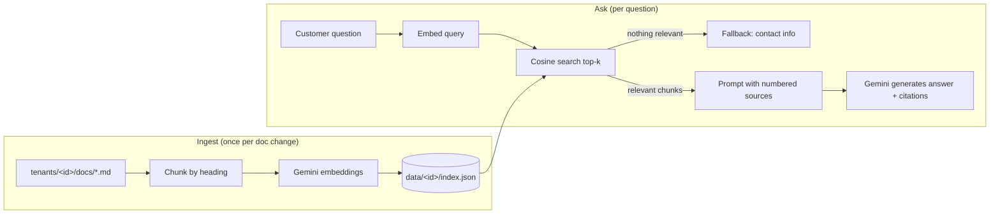

# RAG Support Bot

A customer-support chatbot that answers questions **from a business's own documents**
(menu, hours, policies, FAQs) using Retrieval-Augmented Generation and Google Gemini.
It cites its sources and says "I don't know" instead of inventing answers.

It's built to support many businesses: each one is a **tenant** with its own documents
and settings. Adding a new business means adding a folder, not changing code.

> The demo business, **Bean & Byte Café**, is fictional. Its documents are made up for this project.

## Example (illustrative; replace with a real run or GIF)

```text
You: Do you have oat milk?
Bot: Yes! Oat milk is available for an extra $0.60, along with almond and soy [1].
  [1] menu.md - Menu > Milk Options (score 0.78)

You: Can I get a refund on a gift card?
Bot: Sorry, gift cards can't be refunded or exchanged for cash, but they never expire [1].
  [1] refund-policy.md - Refund and Order Policy > Gift Cards (score 0.81)
```

## How it works



1. **Chunking**: documents are split by Markdown headings so each chunk covers one topic.
   Each chunk keeps its heading path (`Refund Policy > Gift Cards`) for better retrieval.
2. **Embedding and indexing**: chunks are embedded with `gemini-embedding-001` (768 dimensions)
   and saved as JSON. A content hash skips re-embedding when nothing changed.
3. **Retrieval**: the question (plus the previous question, for follow-ups) is embedded
   and compared with cosine similarity.
4. **Grounded answer**: if nothing scores above the threshold, the bot returns the business's
   contact details **without calling the LLM**. This saves quota and prevents made-up answers.
   Otherwise Gemini answers using only the numbered sources and cites them.

## Design decisions

| Decision | Why |
|---|---|
| Channel-independent `Assistant` class | Web chat, WhatsApp, etc. are thin adapters over the same core. |
| `EmbeddingProvider` / `ChatProvider` interfaces | Swap Gemini for another model, and use fakes in tests. |
| Plain REST instead of an SDK | Zero runtime dependencies. The API key goes in a header, never a URL. |
| Brute-force vector search | Simple and fast for a few thousand chunks per business. pgvector is the upgrade path. |
| Documents marked as data in the prompt | Basic defence against prompt injection hidden in uploaded docs. |
| Retry with backoff on 429/5xx | The free tier has rate limits. |
| Validated tenant ids | Tenant ids become folder names, so they can't escape the folder (`../`). |

## Getting started

Requires **Node.js 23.6+**, which runs TypeScript directly with no build step.

```bash
npm install
cp .env.example .env          # then paste your free key from https://aistudio.google.com/apikey
npm run ingest -- bean-and-byte
npm run chat -- bean-and-byte
```

### Add your own business

```text
tenants/
  my-shop/
    tenant.json      # name, assistant name, tone, fallback contact
    docs/
      faq.md
      prices.md
```

Then run `npm run ingest -- my-shop` and `npm run chat -- my-shop`.

## Tests

```bash
npm test          # 22 tests, run offline with fake embeddings and fake HTTP
npm run typecheck
```

## Roadmap

- [x] RAG engine: chunking, embeddings, retrieval, grounded answers with citations
- [x] Multi-tenant document folders
- [ ] Web chat UI with streaming responses
- [ ] HTTP API with rate limiting (keeps the API key on the server)
- [ ] Upload your own documents (PDF/TXT)
- [ ] WhatsApp channel via the WhatsApp Business Cloud API
- [ ] Admin dashboard: unanswered questions, so businesses know which docs to add

## Privacy note

On Gemini's free tier, Google may use prompts to improve its products. Don't upload
sensitive or real customer data to the demo. For real businesses, use the paid tier.

## License

MIT
