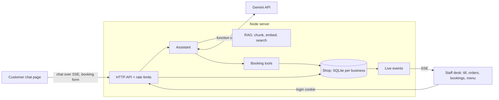

# RAG Support Bot + Shop Desk

[](https://github.com/Kx1742/rag-support-bot/actions/workflows/ci.yml)

A customer-support chatbot for small businesses that **answers questions from the business's own
documents** and **books tables by chatting**, plus a **staff desk** with a till (POS), a kitchen
order queue, a bookings list and menu controls, all updating live.

- **Customers** chat on the website: "Do you have oat milk?", "Table for 4 on Saturday at 10?"
- **The AI** (Google Gemini) answers from the café's documents with citations, and checks availability
  and makes bookings through function calling, using the shop's real booking rules
- **Staff** see new bookings appear instantly on the desk, ring up orders with drink options,
  take cash or card payment, and move orders through New → Preparing → Ready
- **Managers** also refund orders, see the end-of-day sales report, and manage staff accounts

It's multi-tenant: each business is a folder with its own documents, menu, tables and opening hours.

> The demo business, **Bean & Byte Café**, is fictional. Its documents and menu are made up for this project.

<!-- TODO: add screenshots or a GIF of the chat and the desk here -->

## Features

**Customer chat** (`/`)
- Grounded answers with clickable citations, streamed over Server-Sent Events
- **Books and cancels tables in conversation** (Gemini function calling), always confirming first
- "Book a table" form in the chat, which also works without AI
- **My booking**: look up or cancel your own booking with its reference + phone number
- **Knows what's sold out**: with Gemini it reads the live menu (prices, sold out, "only 3 left");
  offline it adds a "Heads up: … is sold out today" notice

**Pickup screen** (`/display`, for a TV at the counter)
- Big "Preparing" and "Ready to collect" order numbers, updated live, newest call first, with a chime
- Shows order numbers only: no names or items
- Follow-up questions, suggested questions, business branding, dark mode, works on phones

**Staff desk** (`/desk`, each person logs in with their own username + PIN)
- **Till / POS**: menu grid by category, item search, **drink options** (size, milk, extra shot, iced...)
  with per-item notes, takeaway or dine-in by table
- **Payments**: cash with quick amounts and change due, or card confirmed from the card machine;
  pay now or keep a table's order open and pay later
- **Order queue**: New → Preparing → Ready → Picked up, with waiting timers, paid/unpaid labels
  and who rang each order up
- **Bookings**: day view, seat, finish, no-show and cancel, plus phone and walk-in bookings with table choice
- **Menu**: sold-out switch, **stock counts** (the till counts down, sells out at 0, can't oversell, and
  stock comes back on cancel/refund); managers **add items, change prices and options, hide items**.
  Desk edits survive changes to `shop.json`
- **Live updates**: new bookings (on any date) and orders appear on every open desk screen instantly
- **Refunds** (managers): with a reason; paid orders can't simply be cancelled
- **End-of-day report** (managers): sales, cash vs card, unpaid, refunds, best sellers, sales by hour, CSV export
- **Staff accounts** (managers): add people, change roles, reset PINs, deactivate

**Engineering**
- Zero runtime dependencies: Node's built-in `node:http`, `node:sqlite` and `fetch`
- Booking rules enforced server-side: opening hours, slot grid, notice period, table sizes,
  overlap checks, per-phone limits
- Prices and option surcharges always come from the server, never from the browser
- Duplicate-order protection: each till order carries an idempotency key, so a network retry can't charge twice
- Rate limiting, a daily AI message cap, strict Content-Security-Policy, no `innerHTML`
- 112 tests, all offline: fake AI, in-memory SQLite, real HTTP server on a random port

## How it works



### Answering questions (RAG)
1. Documents are split by Markdown heading into chunks, embedded with `gemini-embedding-001`, and saved.
2. Each question is searched on its own **and** with the previous question (for follow-ups),
   keeping each chunk's best score.
3. Gemini answers using only the numbered sources and cites them. With no relevant sources
   and no tools, the bot gives the contact details instead of guessing.

### Booking by chat (function calling)
1. The system prompt gives Gemini today's date, a 14-day calendar (models are bad at date maths)
   and the booking rules.
2. Gemini calls `check_availability`. Our code runs the real rules and returns free times or the
   closest alternatives.
3. Gemini summarises the details and asks the customer to confirm. Only after a clear "yes" does
   it call `create_booking`.
4. The chat shows a confirmation card with the reference, and the desk announces the new booking live.

Rule violations ("we seat up to 6") are returned to the model as tool results so it can explain
them. Unexpected errors are not.

## Roles and permissions

| | Customer | Staff | Manager |
|---|:-:|:-:|:-:|
| Chat, book a table, look up / cancel own booking (public site) | ✓ | ✓ | ✓ |
| Ring up orders, take payments, move orders along | – | ✓ | ✓ |
| Create, seat and cancel bookings; mark items sold out; set stock counts | – | ✓ | ✓ |
| Add menu items, change prices and options, hide items | – | – | ✓ |
| Cancel **unpaid** orders | – | ✓ | ✓ |
| Refund paid orders | – | – | ✓ |
| See sales totals and the end-of-day report | – | – | ✓ |
| Add staff, change roles, reset PINs | – | – | ✓ |

- Customers never log in. They prove a booking is theirs with its reference **and** phone number.
- Staff and managers log in at `/desk` with their own **username + PIN** (hashed with scrypt).
  After 5 wrong PINs an account locks for 5 minutes.
- The owner logs in with username `owner` and the `STAFF_PASSWORD` from `.env` (always a manager),
  and uses it to create everyone else's accounts.
- Permissions are checked **on the server on every request** (`src/server/permissions.ts`); the desk only
  hides buttons people can't use. Role changes and deactivation take effect immediately, and a PIN reset
  or deactivation signs that person out everywhere.
- Every order records who rang it up, who took payment and who refunded it.

## Design decisions

| Decision | Why |
|---|---|
| Channel-independent `Assistant` with pluggable tools | Web chat today, WhatsApp next, same brain. |
| `node:sqlite`, one database file per business | Real transactions with zero dependencies, and tenants can't see each other's data. |
| Times stored as shop wall-clock values (`2026-11-14`, minute 600) | Only "now" needs a timezone conversion, which avoids most daylight-saving bugs. |
| Smallest free table that fits | Keeps big tables free for big groups. |
| Customer cancel needs reference **and** phone, same error for both | References can't be guessed or probed. |
| HttpOnly + SameSite=Strict session cookie, JSON-only writes | Blocks cross-site request forgery without CSRF tokens. |
| Constant-time password check, scrypt-hashed PINs, account lockout, login rate limit | No timing leaks or brute force. |
| One permission table used by both the server and the "What each role can do" screen | The help screen can't drift from what's enforced. |
| Options priced and "frozen" onto each order line | Later menu price changes don't rewrite old orders or reports. |
| Stock checked and counted down inside the same transaction as the order | Two tills can't both sell the last croissant. |
| shop.json seeds the menu; the database is the source of truth after that | Managers edit in the desk without touching files, and file updates don't undo their edits. |
| Pickup screen gets numbers only | It's public, so it can't leak names or orders. |
| Server-Sent Events for the desk | Simple one-way live updates over plain HTTP. |
| Offline mode (keyword search, no AI) | Develop and demo without an API key. |

## Getting started

Requires **Node.js 23.6+**, which runs TypeScript directly with no build step.

```bash
npm install
cp .env.example .env    # set STAFF_PASSWORD (8+ chars); add GEMINI_API_KEY for AI answers
npm start
```

- Customer chat: http://localhost:3000
- Staff desk: http://localhost:3000/desk. First log in with business ID `bean-and-byte`, username `owner`
  and the `STAFF_PASSWORD` from `.env`, then add your team on the **Staff** tab

Without `GEMINI_API_KEY` the chat runs in **offline mode**: keyword search, no AI-written answers,
and bookings through the form only. Get a free key at https://aistudio.google.com/apikey.

Other commands:

```bash
npm run dev                   # restart on file changes
npm run chat -- bean-and-byte # chat in the terminal
npm test                      # 112 tests
npm run typecheck
```

### Add your own business

```text
tenants/
  my-shop/
    tenant.json   # name, assistant name, tone, contact, brand color, suggested questions
    shop.json     # optional: timezone, opening hours, tables, booking rules, menu with prices
    docs/*.md     # FAQs, policies, menu text for the chatbot
```

Without `shop.json` the business gets the chatbot only. Data is stored in `data/<id>/` (git-ignored).

### API

| Method | Path | Description |
|---|---|---|
| `GET` | `/api/tenants/:id` | Public business info |
| `POST` | `/api/tenants/:id/chat` | Chat. Body `{ message, history }`; responds with an SSE stream (`sources`, `action`, `delta`, `done`) |
| `GET` | `/api/tenants/:id/availability?date=&partySize=` | Free booking times |
| `GET` | `/api/tenants/:id/pickup`, `.../pickup/events` | Pickup screen numbers and live updates (public) |
| `POST` | `/api/tenants/:id/bookings` | Book a table: `{ date, time, partySize, name, phone, notes? }` |
| `POST` | `/api/tenants/:id/bookings/lookup`, `.../cancel` | Customer: `{ reference, phone }` |
| `POST` | `/api/desk/login`, `/api/desk/logout` | Desk session (cookie): `{ tenantId, username, pin }` |
| `GET`, `POST`, `PATCH` | `/api/desk/orders`, `/api/desk/orders/:id` | Till and order queue; POST takes `items[].options`, `clientRef`, optional `payment` |
| `POST` | `/api/desk/orders/:id/pay`, `/api/desk/orders/:id/refund` | Take payment `{ method, tendered? }`; refund `{ reason }` (manager) |
| `GET` | `/api/desk/report?date=` | End-of-day report (manager) |
| `GET`, `POST`, `PATCH` | `/api/desk/staff`, `/api/desk/staff/:id` | Staff accounts (manager) |
| `GET`, `POST`, `PATCH` | `/api/desk/bookings`, `/api/desk/bookings/:id` | Bookings by day, status changes |
| `GET`, `POST`, `PATCH` | `/api/desk/menu`, `/api/desk/menu/:id` | Menu; PATCH `{ available }` or `{ stock }` (staff), item fields or `{ hidden }` (manager) |
| `GET` | `/api/desk/events` | Live change events (SSE) |

## Roadmap

- [x] RAG engine with citations, multi-tenant
- [x] Streaming web chat, rate-limited API, offline mode
- [x] Table bookings: rules engine, chat booking via function calling, booking form
- [x] Staff desk: till, order queue, bookings, menu, live updates
- [x] Drink options, cash/card payments, refunds, end-of-day report
- [x] Staff accounts with roles (customer / staff / manager)
- [ ] Integrated card payments (Stripe Terminal, test mode first)
- [x] Stock counts, menu & price editing in the desk
- [x] Chatbot reads the live menu; customer pickup screen
- [ ] Loyalty points (the café's docs describe them; the till doesn't support them yet)
- [ ] Deploy a live demo
- [ ] Booking confirmations by SMS/email; WhatsApp channel
- [ ] Customers order ahead through the chat

## Privacy note

Bookings store a name and phone number in the business's local database. On Gemini's free tier,
Google may use prompts to improve its products, so don't use real customer data with the demo.
Use the paid tier for real businesses.

## License

MIT
